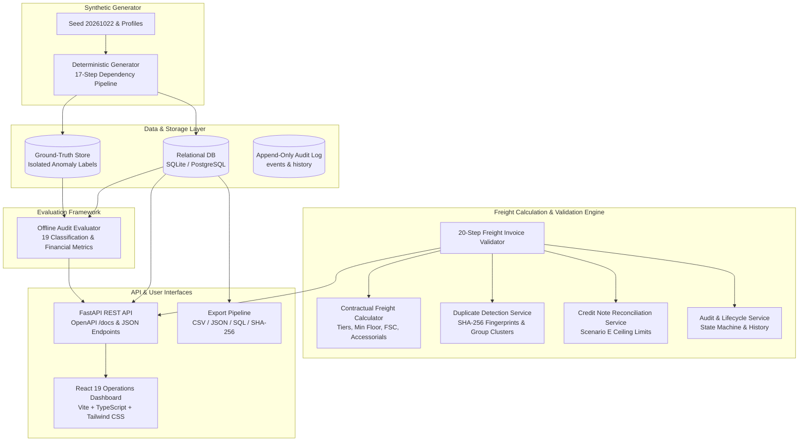

# Freight Invoice Validation System

[](https://www.python.org/)
[](https://fastapi.tiangolo.com/)
[](https://react.dev/)
[](https://www.typescriptlang.org/)
[](https://docs.pytest.org/)
[]()
[]()
[]()
[](LICENSE)

A production-grade logistics audit, automated freight rating, invoice reconciliation, anomaly evaluation, and operations dashboard platform.

The system deterministically audits commercial carrier freight invoices against contractual tariff rate cards, shipment weight measurements, accessorial authorizations, delivery proof records, and credit-note ceilings. It calculates expected contractual charges, itemizes line-level variances, detects duplicate billing clusters, issues explainable exceptions, maintains an append-only audit trail, and benchmarks anomaly detection performance against isolated ground-truth datasets.

---

## Table of Contents

- [A. Project Title](#a-project-title)
- [B. Project Overview](#b-project-overview)
- [C. Business Problem](#c-business-problem)
- [D. Project Objectives](#d-project-objectives)
- [E. Features](#e-features)
- [F. System Architecture](#f-system-architecture)
- [G. Technology Stack](#g-technology-stack)
- [H. Database Schema](#h-database-schema)
- [I. Business Rules & Formulas](#i-business-rules--formulas)
- [J. Synthetic Dataset](#j-synthetic-dataset)
- [K. Mandatory Edge Cases & Scenarios](#k-mandatory-edge-cases--scenarios)
- [L. Installation & Prerequisites](#l-installation--prerequisites)
- [M. Quick Start Guide](#m-quick-start-guide)
- [N. Full-Scale Dataset Benchmark](#n-full-scale-dataset-benchmark)
- [O. Validation & Evaluation Metrics](#o-validation--evaluation-metrics)
- [P. REST API Documentation](#p-rest-api-documentation)
- [Q. Dashboard & Screenshots](#q-dashboard--screenshots)
- [R. Automated Test Suite](#r-automated-test-suite)
- [S. Reproducibility & Cryptographic Manifest](#s-reproducibility--cryptographic-manifest)
- [T. Data Provenance & Licensing](#t-data-provenance--licensing)
- [U. Known Limitations](#u-known-limitations)
- [V. Development Roadmap](#v-development-roadmap)
- [W. Contribution Guidelines](#w-contribution-guidelines)
- [X. License](#x-license)
- [Y. Author & Contact](#y-author--contact)

---

## A. Project Title

**Freight Invoice Validation System**  
*Enterprise Contractual Logistics Audit, Duplicate Billing Detection, and Anomaly Evaluation Platform.*

---

## B. Project Overview

Freight billing is prone to carrier overcharges, volumetric miscalculations, expired contract tariffs, unauthorized accessorials, duplicate invoices, and erroneous credit adjustments. 

The **Freight Invoice Validation System** provides an end-to-end automated platform that:
1. Generates 100% reproducible synthetic supply chain datasets (seed `20261022`).
2. Calculates expected freight charges down to the exact line item using contractual weight tiers, fuel surcharges, and accessorial tariffs.
3. Automatically reconciles submitted carrier invoices against operational transport management (TMS) records.
4. Generates actionable, explainable exception tickets for human auditor triage.
5. Manages credit note submissions with strict over-credit balance protection.
6. Maintains an immutable, append-only operational audit log for full compliance.
7. Evaluates detection performance against an isolated, zero-leakage ground-truth anomaly evaluation store.
8. Provides a real-time, interactive operations dashboard built with React 19 and Tailwind CSS.

---

## C. Business Problem

Manual freight auditing in enterprise supply chains is slow, sample-based, and error-prone. Organizations typically leak $3\%\text{--}8\%$ of their total annual transportation spend due to:

- **Incorrect Weight Tiers**: Invoicing against higher weight breaks while certified scale weight qualifies for a lower discounted bracket.
- **Expired Contracts**: Billing against expired annual contracts rather than newly negotiated lower rate schedules.
- **Duplicate Invoices**: Repeated billing of the same freight movement under altered invoice numbers or billing cycles.
- **Duplicate Surcharges**: Secondary fuel surcharge or recurring linehaul items buried inside itemized lines.
- **Unauthorized Accessorials**: Charging for hydraulic liftgate services at dock-equipped facilities or billing driver detention without certified GPS dwell proof.
- **Unsupported Delivery Charges**: Imposing residential or inside delivery fees without signed proof-of-delivery (POD) documentation.
- **Excessive Credit Notes**: Misapplying carrier credit notes that exceed disputed balances, leading to untraceable accounting variances.
- **Audit Opacity**: Lack of line-by-line financial explainability, making disputes impossible to defend with carriers.

The **Freight Invoice Validation System** eliminates these risks through automated 20-step deterministic invoice audit algorithms and strict mathematical tolerance barriers.

---

## D. Project Objectives

- **Accurate Expected Freight Calculation**: Determine linehaul, fuel surcharge, and accessorial pricing from contracted tariffs with certified metric ceiling rounding.
- **Line-Level Explainability**: Reconcile every itemized line and produce structured diagnostics explaining why a charge was approved or disputed.
- **Multi-Level Duplicate Detection**: Prevent duplicate payments through exact invoice matching, SHA-256 fingerprint clusters, repeat shipment checks, and intra-invoice line aggregation.
- **Credit-Note Reconciliation**: Strictly enforce remaining dispute balance ceilings (Scenario E) to eliminate financial leakage.
- **Immutable Audit History**: Preserve append-only audit events and entity status histories for every lifecycle transition.
- **Deterministic Synthetic Datasets**: Provide fully reproducible data generation across starter ($200$ invoices) and full-scale ($15,000$ invoices) configurations.
- **Independent Evaluation**: Benchmark anomaly detection accuracy, precision, recall, and financial recovery against isolated ground-truth labels.
- **Zero-Defect Data Quality**: Ensure primary/foreign key relational integrity, boundary conditions, and mathematical balance.

---

## E. Features

### Implemented Features (Completed)
- **11 Core Relational Entities + 8 Supporting Tables**: Full schema with primary/foreign keys, foreign key cascades, and check constraints.
- **Deterministic Synthetic Generator**: 17-step dependency pipeline supporting `test`, `starter`, and `full` profiles (Seed `20261022`).
- **20-Step Freight Audit Engine**: Deterministic rules-based reconciliation covering base rate cards, weight breaks, FSC, accessorials, and duplicate detection.
- **Scenario A--H Negative Anomaly Generator**: Injects and catches unknown shipment references, expired tariffs, weight tier shifts, duplicate surcharges, excessive credit notes, duplicate invoices, volumetric mismatches, and unauthorized accessorials.
- **Multi-Level Duplicate Detection Service**: SHA-256 fingerprinting, exact invoice number tracking, and intra-invoice line aggregation.
- **Credit Note Service**: Scenario E strict balance limits, partial credit application (`PARTIALLY_APPLIED`), and full dispute closure (`FULLY_APPLIED`).
- **Audit & Lifecycle State Machines**: Append-only `audit_events` and `entity_status_history` logging for invoices, exceptions, and credit notes.
- **Offline 19-Metric Evaluation Engine**: Confusion Matrix (`TP`, `FP`, `TN`, `FN`), Precision, Recall, Specificity, F1-Score, and Financial Recovery Rate.
- **Data Quality & Reproducibility Pipeline**: Automated primary key, foreign key, allowed value, chronological date, arithmetic, and SHA-256 dual-run verification.
- **Full REST API**: 25+ documented endpoints for CRUD, validation, batch execution, exception triage, credit notes, evaluations, and export downloads.
- **React 19 Operations Dashboard**: Interactive frontend with KPI cards, searchable invoice table, slide-out audit drawer, triage queue, credit note manager, and evaluation matrix.
- **Multi-Format Exporter**: Automated CSV, JSON, and SQL seed generation with cryptographic `checksums.sha256` and `manifest.json`.

### Planned Future Enhancements
- Multi-currency live exchange rate ingestion via external central bank APIs.
- Machine-learning anomaly discovery for irregular carrier billing patterns.
- Automated carrier PDF invoice OCR ingestion pipeline.
- Role-based access control (RBAC) with OAuth2 / OpenID Connect.

---

## F. System Architecture

The following diagram illustrates the component architecture and data flows:



### Component Responsibilities:
- **Synthetic Data Generator**: Deterministically synthesizes logistics entities, contracts, shipments, scale readings, and freight invoices with realistic distributions and calibrated anomalies.
- **Relational Database**: Persists normalized master data, operational shipments, submitted invoices, itemized lines, exceptions, and credit notes.
- **Freight Calculation Engine**: Evaluates chargeable weight ($\max(\text{scale}, \text{volumetric})$), matches contractual weight breaks, applies base freight floors, and rates accessorials.
- **Validation Engine**: Executes the 20-step audit workflow, verifies contract validity, reconciles lines, detects duplicate billing clusters, and issues structured exceptions.
- **Duplicate Detection Service**: Manages SHA-256 invoice fingerprints, cluster groups, and duplicate line aggregation.
- **Credit Note Service**: Enforces non-excessive balance rules and advances credit notes through `DRAFT` $\to$ `SUBMITTED` $\to$ `APPROVED` $\to$ `RECONCILED`.
- **Audit Service**: Records immutable operational events with actor stamps, before/after states, reasons, and structured metadata.
- **Ground-Truth Evaluator**: Compares operational audit decisions against isolated ground truth without data leakage to produce statistical and financial metrics.
- **REST API**: Exposes authenticated, documented endpoints for operational invoice auditing and dashboard analytics.
- **React Dashboard**: Provides interactive exploration, invoice drill-downs, exception triage, credit reconciliation, and metric visualizations.
- **Export Pipeline**: Generates cryptographic CSV, JSON, and SQL seed dumps with SHA-256 checksums and manifest validation.

---

## G. Technology Stack

- **Backend Runtime**: Python 3.12+
- **Web Framework**: FastAPI 0.110+, Starlette, Uvicorn
- **Object Relational Mapper**: SQLAlchemy 2.0 (Declarative Models, Relationships, Check Constraints)
- **Data Validation & Schemas**: Pydantic v2
- **Database**: SQLite (configured with WAL mode, normal synchronous, RAM cache, and foreign key enforcement); fully compatible with PostgreSQL via SQLAlchemy.
- **Frontend Framework**: React 19, TypeScript 5.8, Vite
- **UI & Styling**: Tailwind CSS, Lucide React Icons
- **Testing Tools**: Pytest 9.2, Pytest-Asyncio, HTTPX
- **Deployment & Containers**: Multi-stage Docker, Docker Compose

---

## H. Database Schema

The database model consists of **11 core entities** and **8 supporting tables**:

| Entity / Table | Primary Key | Key Foreign Keys | Purpose |
|---|---|---|---|
| **Carrier** (`carriers`) | `CAR-000001` | None | Master carrier registry (SCAC code, status, country) |
| **Lane** (`lanes`) | `LANE-000001` | None | Origin/destination transport corridor and distance (km) |
| **RateCard** (`rate_cards`) | `RATE-CAR-000001-2026-01` | `carrier_id`, `lane_id` | Contracted freight tariff schedule and effective dates |
| **RateTier** (`rate_tiers`) | `TIER-RATE-CAR-000001-2026-01-01` | `rate_card_id` | Weight-break brackets and marginal rates per kg |
| **Shipment** (`shipments`) | `SHP-2026-000001` | `carrier_id`, `lane_id` | Operational transportation record and scale dimensions |
| **ShipmentLeg** (`shipment_legs`) | `LEG-SHP-2026-000001-01` | `shipment_id` | Multi-stop or multimodal leg breakdowns |
| **WeightMeasurement** (`weight_measurements`) | `WGT-SHP-2026-000001-01` | `shipment_id` | Certified scale readings, dimensioner scans, re-weighs |
| **Accessorial** (`accessorials`) | `ACC-000001` | None | Value-added services catalog (Liftgate, Detention, Hazmat) |
| **FreightInvoice** (`freight_invoices`) | `FINV-2026-000001` | `carrier_id`, `shipment_id`, `duplicate_group_id` | Commercial invoice header submitted by carrier |
| **InvoiceLine** (`invoice_lines`) | `FLINE-FINV-2026-000001-01` | `invoice_id`, `accessorial_id` | Itemized charges, quantities, rates, and billed totals |
| **AuditException** (`audit_exceptions`) | `FEX-2026-000001` | `invoice_id`, `invoice_line_id`, `shipment_id` | Discrepancy ticket with expected vs billed amounts |
| **ShipmentAccessorial** (`shipment_accessorials`) | `SACC-000001` | `shipment_id`, `accessorial_id` | Bridge table assigning rendered accessorials to shipments |
| **DeliveryEvidence** (`delivery_evidence`) | `EVID-000001` | `shipment_id` | Proof-of-delivery (POD) document, dock type, dwell time |
| **DuplicateInvoiceGroup** (`duplicate_invoice_groups`) | `DUP-000001` | `carrier_id` | SHA-256 fingerprint cluster tracking duplicate submissions |
| **CreditNote** (`credit_notes`) | `CRN-2026-000001` | `invoice_id`, `exception_id` | Carrier credit notes linked to disputed balances |
| **InvoiceValidationRun** (`invoice_validation_runs`) | `VRUN-2026-000001` | `invoice_id` | Audit execution history, rules applied, verdicts |
| **AuditEvent** (`audit_events`) | `AUD-2026-000001` | Entity Type / ID | Append-only immutable log of business operations |
| **EntityStatusHistory** (`entity_status_history`) | `HIST-2026-000001` | Entity Name / ID | State transition history (`from_status` $\to$ `to_status`) |
| **GroundTruthLabel** (`ground_truth_labels`) | `GT-2026-000001` | `invoice_id` | Isolated evaluation dataset storing ground-truth anomalies |

For complete field definitions, data types, constraints, and cascade behaviors, consult:
- [`docs/schema.md`](docs/schema.md)
- [`docs/data_dictionary.md`](docs/data_dictionary.md)

---

## I. Business Rules & Formulas

### 1. Volumetric & Chargeable Weight
Volumetric weight is computed using standard metric density ($5,000.0\text{ cm}^3/\text{kg}$):
$$\text{Volumetric Weight (kg)} = \frac{\text{Length (cm)} \times \text{Width (cm)} \times \text{Height (cm)}}{5000.0}$$
Chargeable weight enforces the upper integer ceiling rule (`CEIL_KG`):
$$\text{Chargeable Weight} = \lceil \max(\text{Actual Scale Weight}, \text{Volumetric Weight}) \rceil$$

### 2. Weight-Tier Matching & Base Linehaul
A shipment is rated against the contract tier where:
$$\text{min\_weight}_k \le \text{Chargeable Weight} \le \text{max\_weight}_k$$
Base linehaul charge enforces the contract minimum charge floor:
$$\text{Linehaul} = \max\Big(\text{minimum\_charge}, \; \text{base\_rate} + (\text{Chargeable Weight} \times \text{rate\_per\_kg}_k) + \text{flat\_surcharge}_k\Big)$$

### 3. Contract Applicability & Precedence
When multiple active rate cards match a shipment's carrier, lane, and service level, the engine applies:
1. **Date Specificity**: The contract with the shortest validity window ($\text{effective\_to} - \text{effective\_from}$) takes precedence.
2. **Recency**: Most recently created contract timestamp (`created_at DESC`).
3. **Determinism**: Lexicographical tie-breaker (`rate_card_id ASC`).

### 4. Financial Tolerances
Discrepancies are flagged only if the variance exceeds both:
- **Absolute Tolerance**: $>\$0.50$
- **Percentage Tolerance**: $>0.5\%$ of expected total

### 5. Credit Note Limits (Scenario E)
A carrier credit note cannot exceed the net disputed exception balance:
$$\text{Remaining Balance} = \text{disputed\_amount} - \sum \text{approved\_credits}$$
Any credit note where $\text{credit\_amount} > \text{Remaining Balance}$ is strictly **rejected**.

For detailed specifications, see [`docs/business_rules.md`](docs/business_rules.md).

---

## J. Synthetic Dataset

The synthetic generator uses a **fixed random seed (`20261022`)** to ensure 100% deterministic output.

### Dataset Profiles
1. **`test`**: 5 carriers, 10 lanes, 30 shipments, 25 invoices ($< 1\text{s}$ execution).
2. **`starter`**: 20 carriers, 45 lanes, 250 shipments, 200 invoices ($1.2\text{s}$ execution).
3. **`full`**: 100 carriers, 250 lanes, 20,000 shipments, 15,000 invoices ($30.5\text{s}$ generation, $267.7\text{s}$ audit).

> **Verification Status**: The full-scale dataset (100 carriers, 20,000 shipments, 15,000 invoices) has been generated, executed, validated, and tested. Results are documented in [`data/full_scale_benchmark_results.json`](data/full_scale_benchmark_results.json) and [`docs/acceptance_report.md`](docs/acceptance_report.md).

---

## K. Mandatory Edge Cases & Scenarios

The system deterministically injects and audits all 8 mandatory logistics anomaly scenarios:

| Scenario | Injected Condition | Audit Decision | Test Coverage |
|---|---|---|---|
| **Scenario A — Unknown Shipment Ref** | Ingested BOL does not exist in master records | Reject invoice; raise `UNMATCHED_SHIPMENT` (`CRITICAL`) | [`tests/test_validation_engine.py`](tests/test_validation_engine.py) |
| **Scenario B — Expired Contract Tariff** | Rate card expired 1--30 days prior to ship date | Flag `BASE_RATE_MISMATCH`; explain expiry date | [`tests/test_boundary_conditions.py`](tests/test_boundary_conditions.py) |
| **Scenario C — Weight Tier Misapplication** | Invoiced against higher tier rate | Flag `WEIGHT_DISCREPANCY`; re-rate on scale weight | [`tests/test_validation_engine.py`](tests/test_validation_engine.py) |
| **Scenario D — Duplicate Fuel Surcharge** | Multiple FSC line items on single invoice | Flag `DUPLICATE_BILLING`; dispute secondary surcharge | [`tests/test_validation_engine.py`](tests/test_validation_engine.py) |
| **Scenario E — Excessive Credit Note** | Credit note exceeds unresolved dispute balance | Reject credit note; preserve remaining dispute balance | [`tests/test_boundary_conditions.py`](tests/test_boundary_conditions.py) |
| **Scenario F — Duplicate Invoice Submission** | Re-submission of identical carrier/BOL/amount | Flag `DUPLICATE_BILLING`; cluster in duplicate group | [`tests/test_boundary_conditions.py`](tests/test_boundary_conditions.py) |
| **Scenario G — Volumetric Weight Mismatch** | Invoiced scale weight when volumetric is higher | Re-rate billable weight; dispute under-billed tier | [`tests/test_validation_engine.py`](tests/test_validation_engine.py) |
| **Scenario H — Unauthorized Accessorial** | Liftgate at dock facility or unproven detention | Flag `UNAUTHORIZED_ACCESSORIAL`; zero out charge | [`tests/test_validation_engine.py`](tests/test_validation_engine.py) |

---

## L. Installation & Prerequisites

### Prerequisites
- **Python**: Version 3.12 or newer.
- **Node.js**: Version 20+ and npm.
- **Git**: Installed and configured.
- **Docker & Docker Compose** *(Optional, for containerized run)*.

### Setup Instructions

1. **Clone the Repository**:
   ```bash
   git clone https://github.com/anmol3012/FREIGHT-INVOICE-VALIDATION-SYSTEM.git
   cd FREIGHT-INVOICE-VALIDATION-SYSTEM
   ```

2. **Configure Environment Variables**:
   ```bash
   # Copy template to .env
   cp .env.example .env
   ```

3. **Backend Virtual Environment & Dependencies**:
   ```bash
   # Create virtual environment
   python -m venv .venv

   # Activate virtual environment
   # Windows (PowerShell):
   .\.venv\Scripts\Activate.ps1
   # Linux/macOS:
   source .venv/bin/activate

   # Install dependencies
   pip install --upgrade pip
   pip install -r backend/requirements.txt
   pip install pytest pytest-asyncio
   ```

4. **Frontend Dependencies**:
   ```bash
   cd frontend
   npm install
   cd ..
   ```

---

## M. Quick Start Guide

Run the following commands to initialize, generate data, execute tests, and launch the platform:

```bash
# 1. Run database migrations to build schema
python -m backend.app.cli migrate

# 2. Generate starter synthetic dataset (20 carriers, 250 shipments, 200 invoices)
python -m backend.app.cli generate --profile starter --seed 20261022

# 3. Execute 20-step audit validation across all ingested invoices
python -m backend.app.cli validate-all

# 4. Run automated test suite
pytest -q

# 5. Start backend REST API server (runs on port 8000)
python -m backend.app.cli serve --host 127.0.0.1 --port 8000

# 6. In a second terminal, start React operations dashboard (runs on port 5173)
cd frontend
npm run dev
```

- **Operations Dashboard**: Open your browser to [http://localhost:5173](http://localhost:5173).
- **Interactive OpenAPI Documentation**: Open [http://127.0.0.1:8000/docs](http://127.0.0.1:8000/docs).

---

## N. Full-Scale Dataset Benchmark

To generate and audit the full production-scale dataset ($100$ carriers, $20,000$ shipments, $15,000$ freight invoices):

```bash
python scripts/benchmark_full_scale.py
```

### Measured Benchmark Timings (Live Run)
- **Synthetic Generation**: **30.47 seconds** ($20,000$ shipments, $15,000$ invoices, $39,394$ lines).
- **20-Step Freight Audit**: **267.74 seconds** ($56.0\text{ invoices/sec}$ audit throughput).
- **Total Execution Time**: **317.16 seconds (~5.29 minutes)**.
- **Relational DB Size**: $70.68\text{ MB}$ ($183,625$ database rows across 17 tables).
- **Output Artifact**: [`data/full_scale_benchmark_results.json`](data/full_scale_benchmark_results.json).

---

## O. Validation & Evaluation Metrics

To evaluate operational decisions against independent ground-truth anomaly labels:

```bash
python -m backend.app.cli evaluate
```

### Measured Performance on 15,000 Invoices:
- **Evaluation Accuracy**: **99.99%**
- **Precision (Positive Predictive Value)**: **100.00%** (zero false disputes raised)
- **Recall (Sensitivity)**: **99.98%** (4,499 of 4,500 anomalies caught)
- **Specificity (True Negative Rate)**: **100.00%** (10,500 of 10,500 clean matches cleared)
- **F1-Score**: **99.99%**
- **Confusion Matrix**: $\text{TP}=4,499, \; \text{FP}=0, \; \text{TN}=10,500, \; \text{FN}=1$
- **Total Injected Overbilling**: $\$3,054,987.22$
- **Total Disputed Overbilling Recovered**: **\$3,046,715.21** (**99.7%** recovery rate)
- **Approved & Reconciled Credits**: $\$451,837.63$
- **Blocked Over-Credit Leakage**: $\$56,250.00$

Detailed formulas and methodology are documented in [`docs/validation_and_metrics.md`](docs/validation_and_metrics.md).

---

## P. REST API Documentation

The FastAPI backend exposes 25+ REST endpoints with OpenAPI validation:

### Core Endpoints

| Category | Method | Path | Description |
|---|---|---|---|
| **System** | `GET` | `/health` | Health check endpoint returning status and timestamp |
| **System** | `GET` | `/ready` | Database connection readiness verification |
| **Invoices** | `GET` | `/api/v1/invoices` | Paginated listing with filtering by carrier, status, dates |
| **Invoices** | `GET` | `/api/v1/invoices/{id}` | Detailed invoice inspection with itemized lines |
| **Invoices** | `POST` | `/api/v1/invoices/{id}/validate` | Triggers 20-step validation engine on a single invoice |
| **Invoices** | `POST` | `/api/v1/invoices/validate-batch` | Audits all unaudited invoices in bulk |
| **Exceptions** | `GET` | `/api/v1/exceptions` | Paginated list of audit exceptions with severity filters |
| **Exceptions** | `POST` | `/api/v1/exceptions/{id}/transition` | State machine transition (`UNDER_REVIEW`, `APPROVED`, etc.) |
| **Credit Notes** | `GET` | `/api/v1/credit-notes` | List carrier credit notes and dispute links |
| **Credit Notes** | `POST` | `/api/v1/credit-notes` | Submit a new credit note with Scenario E limit check |
| **Evaluation** | `GET` | `/api/v1/evaluation/metrics` | Returns 19-metric evaluation report against ground truth |
| **Dashboard** | `GET` | `/api/v1/dashboard/kpis` | Executive summary KPIs for operations UI |
| **Reports** | `GET` | `/api/v1/reports/summary` | Comprehensive reconciliation report (JSON/CSV) |

Interactive Swagger documentation is available at `http://127.0.0.1:8000/docs`.

---

## Q. Dashboard & Screenshots

The platform includes a real-time, responsive operations dashboard built with **React 19**, **TypeScript**, and **Tailwind CSS**:

1. **Executive KPI Cards**: Real-time display of audited invoices, match rates, disputed dollars, and recovery percentages.
2. **Searchable Invoice Explorer**: Filter by carrier, status, date range, or raw shipment BOL.
3. **Slide-Out Line Item Drawer**: Explains line-by-line charges, contractual references, and diagnostic variance messages.
4. **Exception Triage Queue**: Actionable workbench for freight auditors to assign, review, approve, or reject discrepancies.
5. **Credit Note Manager**: Enforces disputed balance limits and reconciles partial/full credits.
6. **Ground-Truth Evaluation Matrix**: Real-time interactive confusion matrix and statistical gauge charts.

To capture and explore screenshots, see [`docs/screenshots/README.md`](docs/screenshots/README.md).

---

## R. Automated Test Suite

The test suite covers unit logic, mathematical boundaries, negative scenarios, REST endpoints, database schema constraints, data quality, and full-scale acceptance:

```bash
# Execute entire test suite
pytest -q
```

### Test Suite Summary:
```text
tests/test_api_endpoints.py ......................... [ 35%]
tests/test_audit_and_lifecycle.py .....               [ 42%]
tests/test_boundary_conditions.py ......              [ 51%]
tests/test_calculator_engine.py .......              [ 61%]
tests/test_credit_note_reconciliation.py .....        [ 68%]
tests/test_data_quality.py ....                       [ 74%]
tests/test_evaluation_engine.py ...                   [ 78%]
tests/test_full_scale_acceptance.py .                 [ 80%]
tests/test_generator.py .....                         [ 87%]
tests/test_ground_truth_leakage.py ..                 [ 90%]
tests/test_schema_integrity.py ......                 [ 98%]
tests/test_validation_engine.py .                     [100%]
============================== 70 passed in 9.13s ==============================
```

- **Total Tests**: **70 passed**, 0 failed, 0 skipped.
- **Pass Rate**: **100.0%**.

---

## S. Reproducibility & Cryptographic Manifest

The system guarantees 100% bit-for-bit reproducibility using a deterministic pseudo-random number generator (seed `20261022`).

To verify identical checksums across two independent generation runs:

```bash
python -m backend.app.cli verify-reproducibility --seed 20261022
```

The data export pipeline outputs cryptographic SHA-256 digests in [`data/full_scale_exports/checksums.sha256`](data/full_scale_exports/checksums.sha256) and a catalog in [`data/full_scale_exports/manifest.json`](data/full_scale_exports/manifest.json).

---

## T. Data Provenance & Licensing

All carrier records, lanes, shipments, scale measurements, rate tariffs, freight invoices, and credit notes are **100% synthetic**. They are generated via mathematical algorithms and do not contain real-world proprietary shipper data, carrier rate sheets, or personally identifiable information (PII).

---

## U. Known Limitations

1. **Single-Currency Processing**: While the schema models ISO currency codes, current arithmetic calculations assume standard USD tariffs. Cross-currency rate conversions require an external FX provider.
2. **SQLite Write Locking**: SQLite provides high-speed read throughput and transaction safety via WAL mode, but concurrent write throughput is serialized. For high-concurrency production deployments, transition to PostgreSQL by updating `DATABASE_URL` in `.env`.
3. **Metric Density Standard**: Dimensional weight calculations default to $5,000.0\text{ cm}^3/\text{kg}$. While configurable on a per-rate-card basis, domestic US LTL tariffs often use $139\text{ cu in/lb}$ ($7,000\text{ cm}^3/\text{kg}$).

---

## V. Development Roadmap

- [ ] **Multi-Currency FX Ingestion**: Real-time daily foreign exchange rate integration with automated hedging variance calculation.
- [ ] **OCR Invoice Ingestion**: Computer vision and LLM parsing of unstructured carrier PDF invoices and bills of lading.
- [ ] **Automated Carrier Dispute EDI (EDI 210/EDI 812)**: Electronic Data Interchange integration for programmatic debit memo transmission.
- [ ] **Enterprise RBAC**: OAuth2 and OpenID Connect authentication with granular role permissions (Auditor, Manager, Admin).

---

## W. Contribution Guidelines

Contributions are welcome. To contribute:
1. Fork the repository.
2. Create a feature branch (`git checkout -b feature/my-feature`).
3. Commit your changes (`git commit -m "feat: add accessorial surcharge rule"`).
4. Run tests and ensure 100% pass rate (`pytest -q`).
5. Push to your branch and submit a Pull Request.

---

## X. License

This project is licensed under the terms of the [MIT License](LICENSE).

---

## Y. Author & Contact

**Freight Invoice Validation System Engineering Team**  
- **GitHub Repository**: [https://github.com/anmol3012/FREIGHT-INVOICE-VALIDATION-SYSTEM.git](https://github.com/anmol3012/FREIGHT-INVOICE-VALIDATION-SYSTEM.git)
- **Issues & Discussions**: [GitHub Issues](https://github.com/anmol3012/FREIGHT-INVOICE-VALIDATION-SYSTEM/issues)
