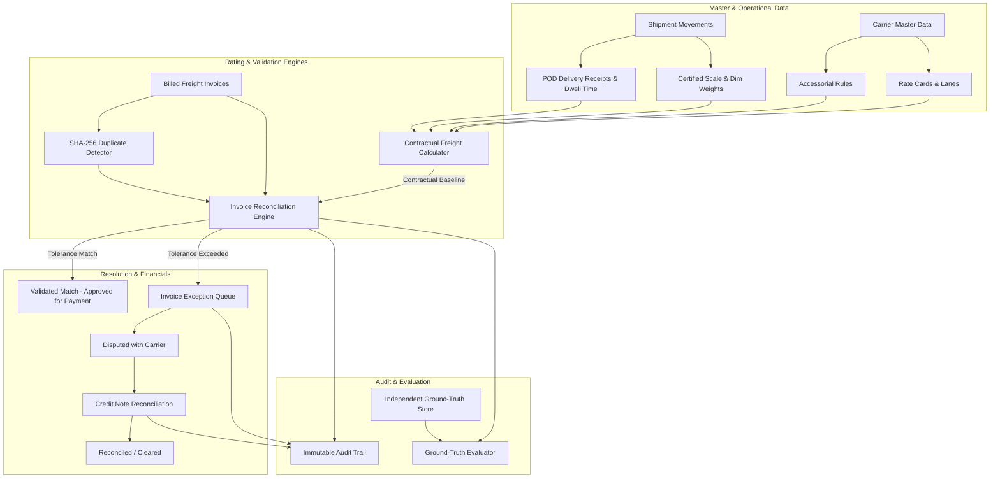

# System Architecture: Freight Invoice Validation System

## 1. Overview
The **Freight Invoice Validation System** solves the critical logistics and accounting challenge of identifying freight invoice discrepancies, overcharges, unauthorized accessorials, duplicate billings, and improper credit notes before payments are disbursed.

---

## 2. System Architecture Diagram

---

## 3. Five Mandatory Negative Scenarios

### Scenario 1: Base Rate / Tariff Mismatch
- **Mechanism**: The carrier bills a base linehaul rate higher than contracted (e.g. applying expired tariff schedules or unauthorized general rate increases) or fails to respect the contracted minimum charge floor.
- **Engine Logic**: The engine queries the carrier's active rate card for the lane (matching origin/destination ZIP prefix or national schedule), recalculates the baseline linehaul ($CWT \times Rate$ or $Miles \times Rate$), and detects any variance exceeding the configured tolerance ($1.00 or 1.0%).
- **Outcome**: Exception raised with category `BASE_RATE_MISMATCH` and root cause `TARIFF_RATE_INFLATION`.

### Scenario 2: Weight / Dimensional Discrepancy
- **Mechanism**: The carrier bills on uncertified re-weigh weight or inflated dimensional weight rather than the certified origin scale slip or true cubic density.
- **Engine Logic**: The engine evaluates certified scale slips and re-computes dimensional weight:
  $$\text{Dimensional Weight} = \frac{\text{Length} \times \text{Width} \times \text{Height}}{\text{Dim Factor (139 cu in/lb)}}$$
  $$\text{Billable Weight} = \max(\text{Gross Weight}, \text{Dimensional Weight})$$
  The engine compares the certified billable weight with the carrier's billed units. If billed weight deviates beyond tolerance, an exception is flagged.
- **Outcome**: Exception raised with category `WEIGHT_DISCREPANCY` and root cause `SCALE_WEIGHT_DISCREPANCY`.

### Scenario 3: Unauthorized or Unrendered Accessorial Charges
- **Mechanism**: The carrier adds accessorial fees for services that were never contracted or never performed at the destination facility:
  - Liftgate billed when delivery receipt proves consignee has a standard dock and no liftgate was used.
  - Driver detention billed when driver dwell time did not exceed contracted free time (e.g. 120 minutes).
- **Engine Logic**: The engine cross-references the carrier's line items against the destination `DeliveryRecord` and GPS/ELD dwell logs. If no physical proof exists, the contractual expected amount is rated at \$0.00.
- **Outcome**: Exception raised with category `UNAUTHORIZED_ACCESSORIAL` and root cause `UNRENDERED_OR_UNAUTHORIZED_ACCESSORIAL`.

### Scenario 4: Duplicate Billing
- **Mechanism**: The carrier submits an identical invoice twice, bills a shipment that has already been validated/paid on a prior invoice, or submits duplicate charges under a different invoice numbering convention.
- **Engine Logic**: The engine computes a deterministic SHA-256 fingerprint:
  $$\text{Fingerprint} = \text{SHA-256}(\text{Carrier ID} : \text{BOL Number} : \text{Total Billed Amount})$$
  It queries prior invoices for matching fingerprints or duplicate billing of the same BOL.
- **Outcome**: The later invoice is immediately flagged with `is_duplicate = True`, linked to `duplicate_of_invoice_id`, and flagged with `DUPLICATE_BILLING`.

### Scenario 5: Invalid / Disallowed or Unreconciled Credit Notes
- **Mechanism**: The carrier issues a credit note referencing a non-existent invoice, a credit note issued to the wrong carrier, or a credit note with an amount exceeding the original invoice's disputed variance balance.
- **Engine Logic**: The engine verifies that the referenced invoice exists, matches the carrier ID, and that:
  $$\text{Credit Note Amount} \le \text{Parent Invoice Variance Balance}$$
  If the credit note is excessive or invalid, it is rejected with an explicit rejection reason and an audit exception is recorded. Valid credit notes are automatically applied to clear open exceptions.
- **Outcome**: Status transitioned to `FULLY_APPLIED` or `REJECTED`.

---

## 4. Evaluation Methodology

Ground-truth labels are created during data synthesis into `ground_truth_labels`. This table is strictly isolated and never accessed by the validation engine during operational auditing.

The evaluation engine compares the operational validation results against the ground truth labels to produce:
- **Confusion Matrix**:
  - **True Positives (TP)**: Injected anomalies correctly caught and flagged.
  - **False Positives (FP)**: Clean invoices incorrectly flagged.
  - **True Negatives (TN)**: Clean invoices correctly passed.
  - **False Negatives (FN)**: Injected anomalies that slipped through undetected.
- **Standard Quality Metrics**: Accuracy, Precision, Recall (Sensitivity), Specificity, and F1-Score.
- **Financial Metric**: Leakage Recovery Rate:
  $$\text{Recovery Rate} = \frac{\text{Total Overbilling Variance Detected}}{\text{Total Injected Anomaly Leakage}} \times 100\%$$
