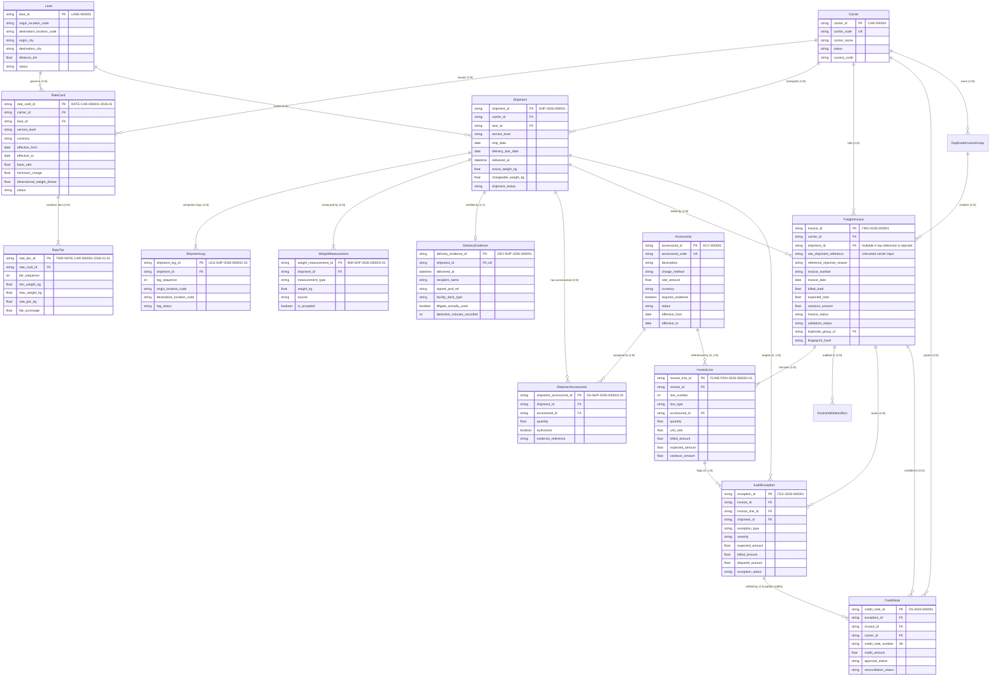
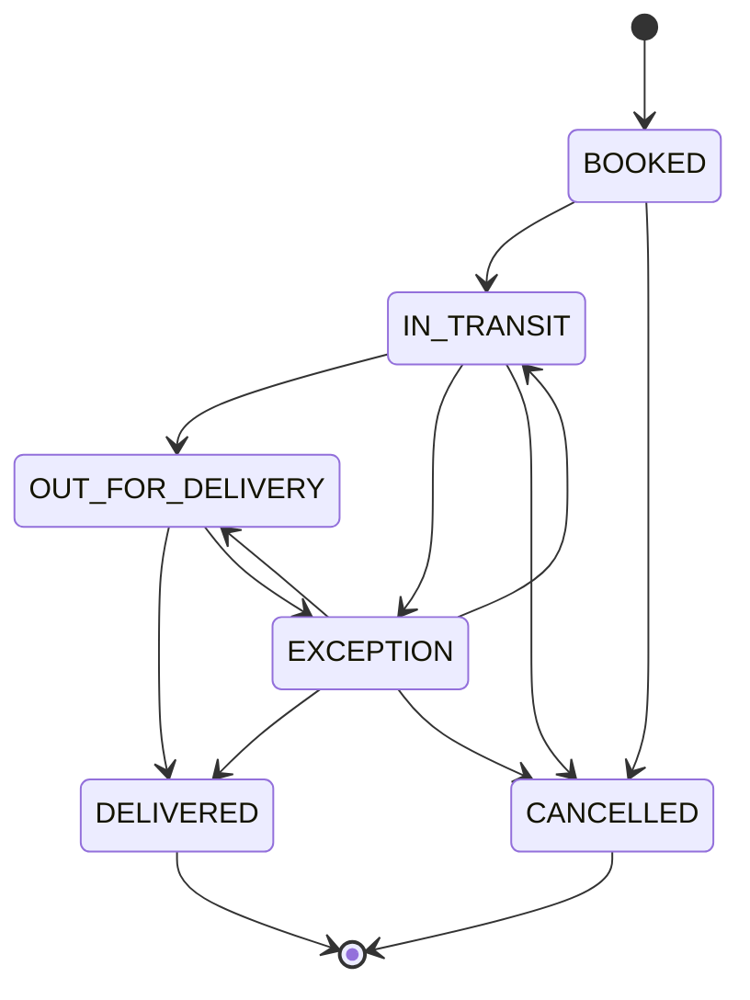
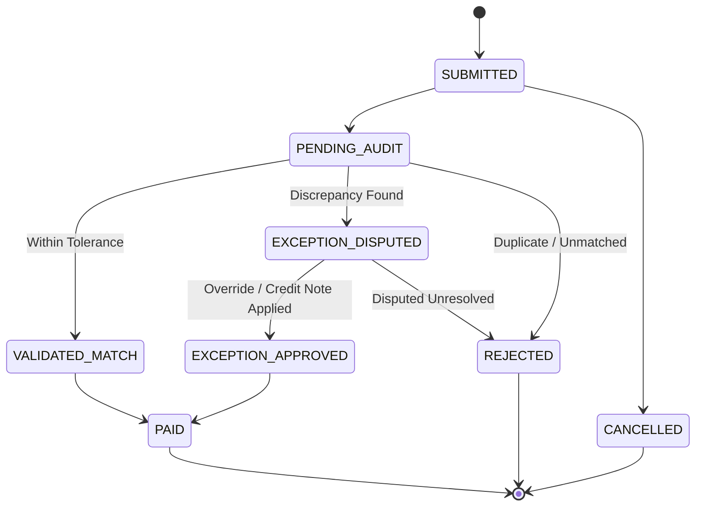
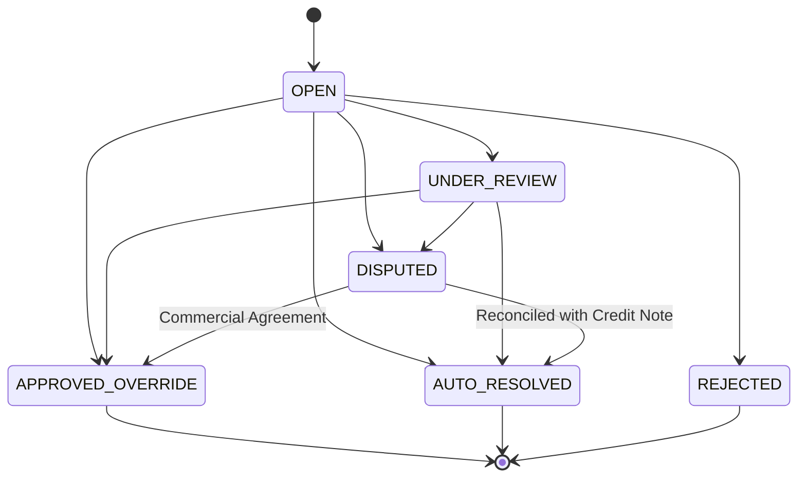
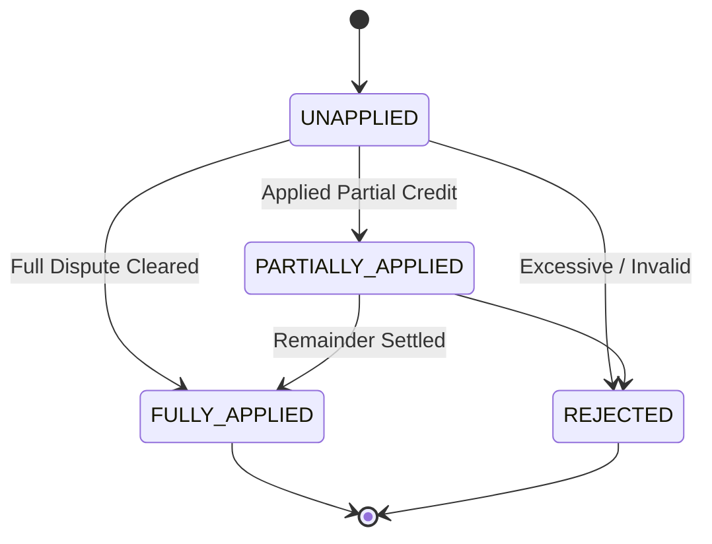

# Relational Schema & System Architecture (Phase 1)

## 1. Complete Entity Relationship Diagram (ERD)

---

## 2. Cardinalities and Relationships

1. **Carrier (1 : N) RateCard**: A carrier maintains one or multiple active tariffs across different lanes, service levels, and contractual validity dates.
2. **Lane (1 : N) RateCard**: Multiple carriers can publish rate cards on the same lane.
3. **RateCard (1 : N) RateTier**: Weight-break pricing intervals ($0 - 500\text{ kg}$, $500 - 2000\text{ kg}$) are modeled explicitly in `RateTier` with `tier_sequence`.
4. **Carrier (1 : N) Shipment**: A carrier executes multiple shipments.
5. **Lane (1 : N) Shipment**: Shipments travel over a specified geographic lane.
6. **Shipment (1 : N) ShipmentLeg**: Complex freight movements contain 1 or more sequential legs with timestamps.
7. **Shipment (1 : N) WeightMeasurement**: Origin scale, destination re-weigh, and dimensional scans are captured as certified readings.
8. **Shipment (N : M) Accessorial**: Linked via `ShipmentAccessorial` bridge table with authorized status, duration/quantity, and document evidence.
9. **Shipment (1 : 1) DeliveryEvidence**: Official POD receipt capturing signed receiver name, dock type, liftgate deployment, and GPS dwell time.
10. **Carrier (1 : N) FreightInvoice**: Carriers submit multiple periodic invoices.
11. **Shipment (1 : N) FreightInvoice**: Supports legitimate partial invoices (e.g. linehaul billed first, supplemental accessorial billed later) and repeat/duplicate invoices.
12. **FreightInvoice (1 : N) InvoiceLine**: Line charges (Linehaul, Fuel, Accessorial, Tax, Misc).
13. **FreightInvoice (1 : N) AuditException**: Discrepancies raised at invoice header or line levels.
14. **InvoiceLine (1 : N) AuditException**: Multiple independent defects on a single line are supported.
15. **AuditException (1 : N) CreditNote**: Partial credit notes settle a disputed exception incrementally.
16. **FreightInvoice (1 : N) AuditEvent**: Immutable write-only log recording every audit, approval, dispute, and override.
17. **Entity (1 : N) EntityStatusHistory**: Explicit historical log recording every state transition.

---

## 3. Untrusted External Shipment Reference Staging

In negative testing and real-world billing, carriers frequently submit invalid, typo-ridden, or fictitious shipment references. To support this without violating SQL foreign key constraints:
- `raw_shipment_reference` (VARCHAR) stores the unvalidated string submitted on the carrier invoice.
- `shipment_id` (VARCHAR) is a nullable foreign key.
- When an invoice arrives:
  - If `raw_shipment_reference` matches a valid `Shipment`, `shipment_id` is linked.
  - If `raw_shipment_reference` does not exist in master records, `shipment_id` is set to `NULL`, `reference_rejection_reason` records the rejection reason, and an `AuditException` of type `UNMATCHED_SHIPMENT` is raised.
  - No database foreign key violation occurs, and the bad invoice is isolated and audited cleanly.

---

## 4. Contractual Effective Date Logic

A `RateCard` is contractually applicable for rating a shipment if and only if:

$$\text{effective\_from} \le \text{shipment.ship\_date} \le \text{effective\_to}$$

- `effective_to` is treated as **inclusive**.
- If `effective_to` is `NULL`, the contract is open-ended and currently in force indefinitely.
- The rating engine validates exact match on `(carrier_id, lane_id, service_level)`. If no active rate card satisfies the date interval, the engine refuses to choose an expired tariff and flags an exception.

---

## 5. Lifecycle State Machines

### 5.1 Shipment Lifecycle

### 5.2 Freight Invoice Lifecycle

### 5.3 Audit Exception Lifecycle

### 5.4 Credit Note Lifecycle

