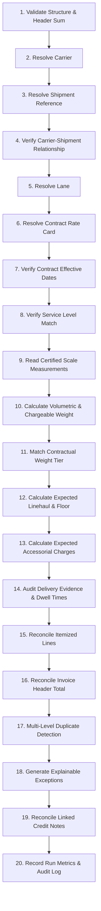

# Freight Calculation & Validation Engine Business Rules

This document specifies the complete rules-based calculation and validation logic implemented in the **Freight Invoice Validation System**.

---

## 1. 20-Step Freight Invoice Audit Workflow

Each freight invoice undergoes the following sequential deterministic audit workflow:

---

## 2. Mathematical Calculations & Formulas

### 2.1 Dimensional & Chargeable Weight
Volumetric weight is computed using the metric air/freight standard:
$$\text{Volumetric Weight (kg)} = \frac{\text{Length (cm)} \times \text{Width (cm)} \times \text{Height (cm)}}{5000.0}$$

The certified billable weight enforces the upper integer ceiling rule (`CEIL_KG`):
$$\text{Chargeable Weight} = \lceil \max(\text{Actual Scale Weight}, \text{Volumetric Weight}) \rceil$$

### 2.2 Weight Tier Selection & Linehaul Pricing
Given a rate card with discrete tiers $[\text{Tier}_1, \text{Tier}_2, \dots, \text{Tier}_n]$:
$$\text{Applicable Tier} = \text{Tier}_k \iff \text{min\_weight}_k \le \text{Chargeable Weight} \le \text{max\_weight}_k$$
*(Where $\text{max\_weight}_n = \infty$ for the open upper bracket).*

The base freight linehaul charge is:
$$\text{Calculated Linehaul} = \max\Big(\text{minimum\_charge}, \; \text{base\_rate} + (\text{Chargeable Weight} \times \text{rate\_per\_kg}_k) + \text{flat\_surcharge}_k\Big)$$

### 2.3 Fuel Surcharge (FSC)
Fuel surcharge is computed either as a contractual percentage of base linehaul:
$$\text{FSC} = \text{Calculated Linehaul} \times \text{fsc\_percentage}$$
or as a mileage-indexed rate:
$$\text{FSC} = \text{distance\_km} \times \text{fuel\_rate\_per\_km}$$

---

## 3. Contract Precedence & Selection Rules

When searching for the contractual rate card for an invoice:
1. **Filtering**:
   - `RateCard.carrier_id == invoice.carrier_id`
   - `RateCard.lane_id == shipment.lane_id`
   - `RateCard.service_level == shipment.service_level`
   - `RateCard.status == 'ACTIVE'`
2. **Effective Date Bracket**:
   $$\text{effective\_from} \le \text{shipment.ship\_date} \le \text{effective\_to} \quad (\text{or } \text{effective\_to IS NULL})$$
3. **Precedence Ranking (if multiple competing active contracts match)**:
   - **Specificity**: Narrowest effective date range ($\text{effective\_to} - \text{effective\_from}$) takes precedence.
   - **Recency**: Most recently created contract timestamp (`created_at DESC`).
   - **Determinism**: Lexicographical tie-breaker (`rate_card_id ASC`).
4. **Diagnostic Status**:
   - If contract exists but $\text{ship\_date} > \text{effective\_to}$, status is set to `EXPIRED` (Scenario B).
   - If zero matching contracts exist, status is set to `MISSING`.

---

## 4. Multi-Layer Duplicate Billing Detection

Duplicate billing is evaluated across 4 distinct independent layers:

1. **Exact Invoice Number**:
   Checks whether the identical `invoice_number` was previously submitted by the same `carrier_id`:
   $$\text{Carrier ID} = c \land \text{Invoice Number} = n \land \text{Invoice ID} \ne i$$

2. **Cryptographic Fingerprint Clustering**:
   Computes SHA-256 hash of key business attributes:
   $$\text{Fingerprint} = \text{SHA-256}\big(\text{carrier\_id} \;\|\; \text{raw\_shipment\_reference} \;\|\; \text{billed\_total}\big)$$
   If matched with an earlier invoice, assigns invoice to `DuplicateInvoiceGroup`.

3. **Repeated Shipment Billing**:
   If an invoice attempts to bill a shipment reference that was already audited with status `VALIDATED_MATCH` or `PAID`, it is flagged with `DUPLICATE_BILLING`.

4. **Internal Duplicate Line Items**:
   Aggregates lines within the invoice itself. If multiple lines exist for the same charge type (e.g., secondary Fuel Surcharge on line 3), the duplicate line is flagged and disputed (Scenario D).

---

## 5. Delivery Evidence & Accessorial Audit Rules

Accessorial charges are audited against contractual entitlements and physical evidence:

| Accessorial Code | Billing Rule | Required Supporting Evidence |
|---|---|---|
| **LIFTGATE** | Flat surcharge | Facility dock type must **not** be `STANDARD_DOCK` or `CROSS_DOCK` |
| **DETENTION** | Hourly rate after free dwell threshold | Driver dwell time at facility $> 120\text{ minutes}$ |
| **RESIDENTIAL** | Flat surcharge | Destination location tagged as residential zoning |
| **INSIDE_DELIVERY** | Flat surcharge | Proof-of-delivery signed with inside delivery tag |
| **HAZMAT** | Flat surcharge | Shipment manifest declared with hazardous UN code |
| **APPOINTMENT** | Flat surcharge | Signed delivery appointment scheduling confirmation |

---

## 6. Financial Tolerances & Dispute Thresholds

- **Absolute Discrepancy Tolerance**: $\$0.50$
- **Relative Variance Tolerance**: $0.5\%$ ($0.005$)
- An exception is raised only if the discrepancy exceeds both the absolute and percentage thresholds:
  $$\text{Disputed Amount} > \max\big(\$0.50, \; 0.005 \times \text{expected\_amount}\big)$$

---

## 7. Credit Note Reconciliation Rules (Scenario E)

1. **Disputed Balance Ceiling**:
   A carrier credit note cannot exceed the net disputed exception balance:
   $$\text{Remaining Balance} = \text{disputed\_amount} - \sum \text{approved\_credits}$$
   $$\text{Credit Note Rejected} \iff \text{credit\_amount} > \text{Remaining Balance}$$
2. **Partial Credit Application**:
   - If $\text{credit\_amount} < \text{Remaining Balance}$:
     - Status becomes `PARTIALLY_APPLIED`.
     - Exception remains `UNDER_REVIEW`.
   - If $\text{credit\_amount} == \text{Remaining Balance}$:
     - Status becomes `FULLY_APPLIED`.
     - Exception transitions to `RESOLVED`.

---

## 8. Lifecycle State Machines

### 8.1 Freight Invoice Lifecycle
$$\text{SUBMITTED} \longrightarrow \begin{cases} \text{VALIDATED\_MATCH} \longrightarrow \text{APPROVED\_FOR\_PAYMENT} \longrightarrow \text{PAID} \\ \text{EXCEPTION\_DISPUTED} \longrightarrow \begin{cases} \text{APPROVED\_FOR\_PAYMENT} \text{ (after override)} \\ \text{REJECTED} \\ \text{CREDITED} \text{ (after credit reconciliation)} \end{cases} \end{cases}$$

### 8.2 Audit Exception Lifecycle
$$\text{OPEN} \longrightarrow \text{UNDER\_REVIEW} \longrightarrow \begin{cases} \text{APPROVED} \longrightarrow \text{RESOLVED} \\ \text{REJECTED} \\ \text{CANCELLED} \end{cases}$$

### 8.3 Credit Note Lifecycle
$$\text{DRAFT} \longrightarrow \text{SUBMITTED} \longrightarrow \begin{cases} \text{APPROVED} \longrightarrow \begin{cases} \text{PARTIALLY\_APPLIED} \\ \text{FULLY\_APPLIED} \end{cases} \\ \text{REJECTED} \end{cases}$$
