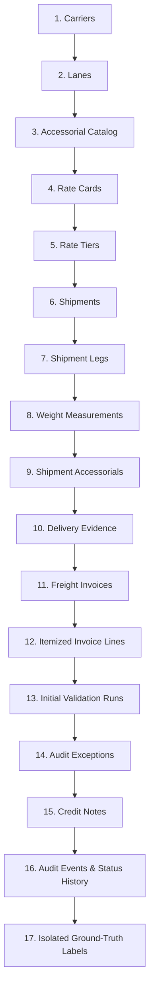

# Deterministic Synthetic Data Generator

This document details the architecture, profiles, distributions, and anomaly injection mechanisms of the **Deterministic Synthetic Data Generator**.

---

## 1. 17-Step Dependency Generation Pipeline

Records are synthesized in strict dependency order, ensuring child entities are never instantiated before their required parent foreign keys exist:



---

## 2. Configuration Profiles

The generator supports three preset configurations utilizing the identical underlying generation logic:

| Profile | Carriers | Lanes | Accessorials | Shipments | Invoices | Default Seed | Typical Runtime | Target Use Case |
|---|---|---|---|---|---|---|---|---|
| **`test`** | 5 | 10 | 6 | 30 | 25 | `20261022` | $< 1\text{s}$ | Fast CI & Unit Testing |
| **`starter`** | 20 | 45 | 6 | 250 | 200 | `20261022` | $1.2\text{s}$ | Local Dev & UI Prototyping |
| **`full`** | 100 | 250 | 8 | 20,000 | 15,000 | `20261022` | $30.5\text{s}$ | Production Acceptance Benchmark |

---

## 3. Realistic Distributions & Physical Variability

- **Hubs & Distance**: 20 major North American logistics hubs (e.g., `ORD`, `ATL`, `DFW`, `LAX`, `JFK`). Haul distances range realistically between $220.0\text{ km}$ and $3,200.0\text{ km}$.
- **Shipment Dates**: Spread across a full 275-day operational calendar starting from `2026-01-01`.
- **Dimensions & Scale Weights**:
  - Pieces: Uniform discrete distribution $[1, 10]$.
  - Length, Width, Height: Continuous log-normal distributions between $20\text{ cm}$ and $240\text{ cm}$.
  - Scale Weights: Range between $15.0\text{ kg}$ and $3,500.0\text{ kg}$ across LTL freight classes.
- **Service Level Mix**: Standard Freight ($60\%$), Expedited ($25\%$), Deferred ($10\%$), Guaranteed AM ($5\%$).

---

## 4. Anomaly Injection & Negative Scenarios

Anomalies are injected deterministically via a cycle schedule so that even small test runs exhibit every negative case:

```python
SCENARIO_CYCLE = [
    "NORMAL", "NORMAL", "UNKNOWN_SHIPMENT_REF", "NORMAL",
    "EXPIRED_RATE_CARD", "NORMAL", "INCORRECT_WEIGHT_TIER", "NORMAL",
    "NORMAL", "DUPLICATE_FUEL_SURCHARGE", "NORMAL", "EXCESSIVE_CREDIT_NOTE",
    "NORMAL", "DIMENSIONAL_WEIGHT_DISCREPANCY", "NORMAL", "NORMAL",
    "UNAUTHORIZED_ACCESSORIAL", "NORMAL", "DUPLICATE_INVOICE", "NORMAL"
]
```

### Injected Scenario Details:
1. **Scenario A — Unknown Shipment Reference (`UNKNOWN_SHIPMENT_REF`)**:
   - Generates an untrusted reference `SHP-FAKE-999999` not present in the shipments table.
2. **Scenario B — Expired Rate Card (`EXPIRED_RATE_CARD`)**:
   - Assigns a rate card with `effective_to` set 1 to 30 days prior to the shipment date.
3. **Scenario C — Weight Tier Misapplication (`INCORRECT_WEIGHT_TIER`)**:
   - Invoices against a higher weight tier rate while actual scale weight qualifies for Tier 1.
4. **Scenario D — Duplicate Fuel Surcharge (`DUPLICATE_FUEL_SURCHARGE`)**:
   - Inserts two distinct `FUEL_SURCHARGE` lines on the invoice.
5. **Scenario E — Excessive Credit Note (`EXCESSIVE_CREDIT_NOTE`)**:
   - Carrier credit note issued for $150\%$ of the disputed exception balance.
6. **Scenario F — Duplicate Invoice Submission (`DUPLICATE_INVOICE`)**:
   - Re-submits an identical invoice number, shipment reference, and total amount.
7. **Scenario G — Volumetric Discrepancy (`DIMENSIONAL_WEIGHT_DISCREPANCY`)**:
   - Billed scale weight when volumetric weight exceeds actual scale weight.
8. **Scenario H — Unauthorized Accessorial (`UNAUTHORIZED_ACCESSORIAL`)**:
   - Charges for `LIFTGATE` at a dock facility or `DETENTION` with $< 120\text{ min}$ dwell time.

---

## 5. Independent Ground-Truth Evaluation Store

- Ground-truth labels are stored in the isolated `ground_truth_labels` table.
- Contains the expected audit decision (`PASS` or `FAIL`), the ground-truth anomaly type, and the exact injected overbilling variance amount.
- **Strict AST Zero-Leakage Guarantee**: The operational audit engine (`backend/app/engine/validator.py`) has zero imports, queries, or knowledge of the ground-truth table.

---

## 6. Multi-Format Cryptographic Exports

The data exporter dumps the populated database into:
1. `csv/`: Normalized CSV file for each of the 17 tables.
2. `json/`: Hierarchical structured JSON files.
3. `sql/`: ANSI-compliant SQL `INSERT` statements for database seeding.
4. `checksums.sha256`: SHA-256 cryptographic digest of every exported file.
5. `manifest.json`: JSON catalog with file paths, record counts, and byte sizes.
