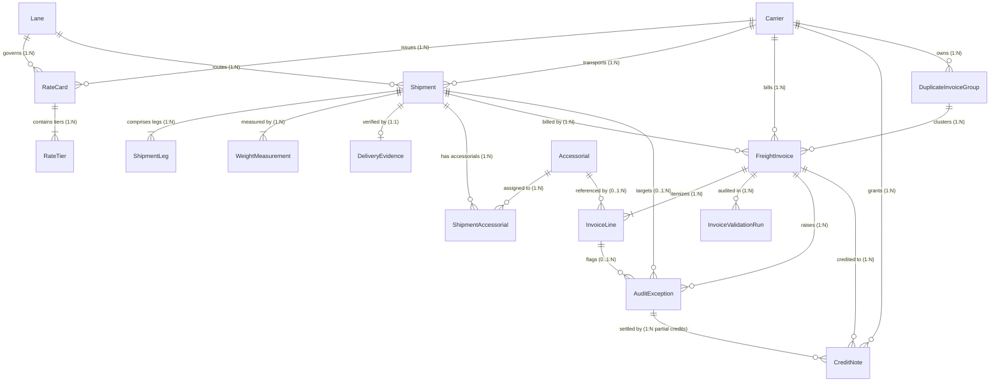

# Relational Database Schema & Data Model

This document specifies the complete normalized relational schema for the **Freight Invoice Validation System**, encompassing the 11 core domain entities, 8 supporting operational tables, deterministic primary keys, foreign key constraints, indexes, and cardinality rules.

---

## 1. Entity Relationship Diagram (ERD)

---

## 2. Core Entities (11 Entities)

### 2.1 Carrier (`carriers`)
Master registry of commercial freight transportation providers.
- **Primary Key**: `carrier_id` (e.g., `CAR-000001`, `VARCHAR(30)`)
- **Columns**:
  - `carrier_name` (`VARCHAR(150)`, `NOT NULL`): Legal entity trade name.
  - `carrier_code` (`VARCHAR(20)`, `UNIQUE`, `NOT NULL`): SCAC / internal code (e.g., `ODFL`, `FXFE`).
  - `status` (`ENUM(CarrierStatus)`, `NOT NULL`): `ACTIVE`, `INACTIVE`, `SUSPENDED`.
  - `country_code` (`VARCHAR(3)`, `NOT NULL`, default `USA`): ISO alpha-3 code.
  - `created_at` / `updated_at` (`DATETIME`).
- **Cardinality**: 1:N with `RateCard`, `Shipment`, `FreightInvoice`, `CreditNote`, `DuplicateInvoiceGroup`.

### 2.2 Lane (`lanes`)
Geographic origin-to-destination transport corridor.
- **Primary Key**: `lane_id` (e.g., `LANE-000001`, `VARCHAR(30)`)
- **Columns**:
  - `origin_location_code` (`VARCHAR(10)`, `NOT NULL`, indexed): Origin airport/hub code.
  - `destination_location_code` (`VARCHAR(10)`, `NOT NULL`, indexed): Destination hub code.
  - `origin_city` / `destination_city` (`VARCHAR(100)`).
  - `origin_country` / `destination_country` (`VARCHAR(3)`).
  - `distance_km` (`FLOAT`, `CHECK distance_km > 0`).
  - `status` (`ENUM(LaneStatus)`, `NOT NULL`): `ACTIVE`, `INACTIVE`.
- **Constraints**: `UNIQUE(origin_location_code, destination_location_code)`.

### 2.3 RateCard (`rate_cards`)
Contracted freight tariff agreement for a carrier, lane, and service level.
- **Primary Key**: `rate_card_id` (e.g., `RATE-CAR-000001-2026-01`, `VARCHAR(50)`)
- **Foreign Keys**:
  - `carrier_id` $\to$ `carriers.carrier_id` (`ON DELETE CASCADE`)
  - `lane_id` $\to$ `lanes.lane_id` (`ON DELETE CASCADE`)
- **Columns**:
  - `service_level` (`ENUM(ServiceLevel)`): `STANDARD`, `EXPEDITED`, `DEFERRED`, `GUARANTEED`.
  - `currency` (`VARCHAR(3)`, default `USD`).
  - `effective_from` (`DATE`, `NOT NULL`, indexed): Start date.
  - `effective_to` (`DATE`, `NULLABLE`, indexed): End date (inclusive, `NULL` = open-ended).
  - `base_rate` (`FLOAT`, `CHECK >= 0`).
  - `minimum_charge` (`FLOAT`, `CHECK >= 0`): Contract floor price.
  - `dimensional_weight_divisor` (`FLOAT`, default `5000.0`, `CHECK > 0`): Metric divisor.
  - `status` (`ENUM(RateCardStatus)`): `ACTIVE`, `EXPIRED`, `SUPERSEDED`, `DRAFT`.
- **Constraints**: `CHECK((effective_to IS NULL) OR (effective_from <= effective_to))`.

### 2.4 RateTier (`rate_tiers`)
Weight breaks and marginal pricing per kilogram for rate cards.
- **Primary Key**: `rate_tier_id` (e.g., `TIER-RATE-CAR-000001-2026-01-01`, `VARCHAR(60)`)
- **Foreign Key**: `rate_card_id` $\to$ `rate_cards.rate_card_id` (`ON DELETE CASCADE`)
- **Columns**:
  - `tier_sequence` (`INTEGER`, `NOT NULL`): Sequence ordinal ($1, 2, 3\dots$).
  - `min_weight_kg` (`FLOAT`, `CHECK >= 0`): Inclusive lower bound.
  - `max_weight_kg` (`FLOAT`, `NULLABLE`): Inclusive upper bound (`NULL` = open bracket).
  - `rate_per_kg` (`FLOAT`, `CHECK >= 0`).
  - `flat_surcharge` (`FLOAT`, default `0.0`).
- **Constraints**: `UNIQUE(rate_card_id, tier_sequence)`, `CHECK(min_weight_kg < max_weight_kg OR max_weight_kg IS NULL)`.

### 2.5 Shipment (`shipments`)
Operational physical freight transportation record.
- **Primary Key**: `shipment_id` (e.g., `SHP-2026-000001`, `VARCHAR(30)`)
- **Foreign Keys**:
  - `carrier_id` $\to$ `carriers.carrier_id`
  - `lane_id` $\to$ `lanes.lane_id`
- **Columns**:
  - `ship_date` (`DATE`, `NOT NULL`, indexed).
  - `delivery_due_date` (`DATE`, `NOT NULL`).
  - `actual_delivery_date` (`DATE`, `NULLABLE`).
  - `service_level` (`ENUM(ServiceLevel)`).
  - `status` (`ENUM(ShipmentStatus)`): `DISPATCHED`, `IN_TRANSIT`, `DELIVERED`, `EXCEPTION`, `CANCELLED`.
  - `pieces` (`INTEGER`, default `1`, `CHECK pieces >= 1`).
  - `declared_weight_kg` (`FLOAT`, `CHECK declared_weight_kg >= 0`).
  - `length_cm`, `width_cm`, `height_cm` (`FLOAT`, `CHECK > 0`).
  - `volumetric_weight_kg` (`FLOAT`, `CHECK >= 0`).
  - `chargeable_weight_kg` (`FLOAT`, `CHECK >= 0`).
  - `is_hazardous` (`BOOLEAN`, default `FALSE`).
- **Constraints**: `CHECK(ship_date <= delivery_due_date)`.

### 2.6 ShipmentLeg (`shipment_legs`)
Multimodal or multi-stop leg breakdown of a primary shipment.
- **Primary Key**: `leg_id` (e.g., `LEG-SHP-2026-000001-01`, `VARCHAR(40)`)
- **Foreign Key**: `shipment_id` $\to$ `shipments.shipment_id` (`ON DELETE CASCADE`)
- **Columns**:
  - `leg_sequence` (`INTEGER`, `NOT NULL`, `CHECK >= 1`).
  - `origin_hub` / `destination_hub` (`VARCHAR(10)`).
  - `transport_mode` (`VARCHAR(20)`, default `ROAD`).
  - `carrier_id` (`VARCHAR(30)`).
  - `status` (`ENUM(ShipmentLegStatus)`): `PENDING`, `IN_TRANSIT`, `COMPLETED`.
- **Constraints**: `UNIQUE(shipment_id, leg_sequence)`.

### 2.7 WeightMeasurement (`weight_measurements`)
Certified scale, dimensioner, and re-weigh inspection logs.
- **Primary Key**: `measurement_id` (e.g., `WGT-SHP-2026-000001-01`, `VARCHAR(40)`)
- **Foreign Key**: `shipment_id` $\to$ `shipments.shipment_id` (`ON DELETE CASCADE`)
- **Columns**:
  - `measurement_type` (`ENUM(MeasurementType)`): `ACTUAL_SCALE`, `DIMENSIONAL_SCAN`, `DECLARED`, `REWEIGH_INSPECTION`.
  - `source` (`ENUM(MeasurementSource)`): `SHIPPER`, `CARRIER_ORIGIN_SCALE`, `CARRIER_HUB_DIMENSIONER`, `CERTIFIED_WEIGH_STATION`.
  - `weight_kg` (`FLOAT`, `CHECK weight_kg > 0`).
  - `scale_device_id` (`VARCHAR(50)`).
  - `measurement_timestamp` (`DATETIME`, `NOT NULL`).
  - `is_accepted_for_rating` (`BOOLEAN`, default `TRUE`).

### 2.8 Accessorial (`accessorials`)
Standardized catalog of value-added and surcharge services.
- **Primary Key**: `accessorial_id` (e.g., `ACC-000001`, `VARCHAR(30)`)
- **Columns**:
  - `accessorial_code` (`VARCHAR(30)`, `UNIQUE`, `NOT NULL`): `LIFTGATE`, `DETENTION`, `RESIDENTIAL`, `INSIDE_DELIVERY`, `HAZMAT`, `APPOINTMENT`, `RECONSIGNMENT`, `STORAGE`.
  - `name` (`VARCHAR(100)`, `NOT NULL`).
  - `charge_method` (`ENUM(ChargeMethod)`): `FLAT`, `PER_KG`, `PER_KM`, `PER_HOUR`, `PERCENTAGE_OF_BASE`.
  - `default_unit_rate` (`FLOAT`, `CHECK >= 0`).
  - `requires_authorization` (`BOOLEAN`, default `FALSE`).
  - `requires_delivery_proof` (`BOOLEAN`, default `FALSE`).
  - `status` (`ENUM(AccessorialStatus)`, default `ACTIVE`).

### 2.9 FreightInvoice (`freight_invoices`)
Commercial invoice submitted by carrier.
- **Primary Key**: `invoice_id` (e.g., `FINV-2026-000001`, `VARCHAR(40)`)
- **Foreign Keys**:
  - `carrier_id` $\to$ `carriers.carrier_id`
  - `shipment_id` $\to$ `shipments.shipment_id` (`NULLABLE`, populated when validly resolved)
  - `duplicate_group_id` $\to$ `duplicate_invoice_groups.group_id` (`NULLABLE`)
- **Columns**:
  - `invoice_number` (`VARCHAR(50)`, `NOT NULL`, indexed).
  - `raw_shipment_reference` (`VARCHAR(50)`, `NOT NULL`, indexed): Untrusted ingested reference.
  - `reference_rejection_reason` (`VARCHAR(255)`, `NULLABLE`): Captured on Scenario A.
  - `invoice_date` / `service_period_start` / `service_period_end` / `due_date` (`DATE`).
  - `currency` (`VARCHAR(3)`, default `USD`).
  - `billed_total` (`FLOAT`, `CHECK >= 0`).
  - `expected_total` (`FLOAT`, `CHECK >= 0`).
  - `variance_amount` (`FLOAT`): Billed minus expected.
  - `invoice_status` (`ENUM(InvoiceStatus)`): `DRAFT`, `SUBMITTED`, `VALIDATED_MATCH`, `EXCEPTION_DISPUTED`, `APPROVED_FOR_PAYMENT`, `PAID`, `REJECTED`, `CREDITED`.
  - `validation_status` (`ENUM(ValidationStatus)`): `UNAUDITED`, `PASSED`, `FAILED`, `REVIEW_REQUIRED`.
  - `fingerprint_hash` (`VARCHAR(64)`, indexed): SHA-256 `carrier_id:raw_ref:billed_total`.
- **Constraints**: `UNIQUE(carrier_id, invoice_number)`, `CHECK(service_period_start <= service_period_end)`.

### 2.10 InvoiceLine (`invoice_lines`)
Itemized line-item charges on an invoice.
- **Primary Key**: `invoice_line_id` (e.g., `FLINE-FINV-2026-000001-01`, `VARCHAR(50)`)
- **Foreign Keys**:
  - `invoice_id` $\to$ `freight_invoices.invoice_id` (`ON DELETE CASCADE`)
  - `accessorial_id` $\to$ `accessorials.accessorial_id` (`NULLABLE`)
- **Columns**:
  - `line_number` (`INTEGER`, `CHECK line_number >= 1`).
  - `line_type` (`ENUM(InvoiceLineType)`): `BASE_LINEHAUL`, `FUEL_SURCHARGE`, `ACCESSORIAL`, `DISCOUNT`, `TAX`, `MISC_SURCHARGE`.
  - `description` (`VARCHAR(200)`).
  - `quantity` (`FLOAT`, default `1.0`).
  - `unit_of_measure` (`VARCHAR(20)`, default `KG`).
  - `unit_rate` (`FLOAT`, default `0.0`).
  - `billed_amount` (`FLOAT`, `CHECK >= 0`).
  - `expected_amount` (`FLOAT`, `CHECK >= 0`).
  - `variance_amount` (`FLOAT`).
  - `evidence_reference` (`VARCHAR(100)`).
- **Constraints**: `UNIQUE(invoice_id, line_number)`.

### 2.11 AuditException (`audit_exceptions`)
Discrepancy and variance ticket raised by the validation engine.
- **Primary Key**: `exception_id` (e.g., `FEX-2026-000001`, `VARCHAR(40)`)
- **Foreign Keys**:
  - `invoice_id` $\to$ `freight_invoices.invoice_id` (`ON DELETE CASCADE`)
  - `invoice_line_id` $\to$ `invoice_lines.invoice_line_id` (`NULLABLE`)
  - `shipment_id` $\to$ `shipments.shipment_id` (`NULLABLE`)
- **Columns**:
  - `exception_type` (`ENUM(ExceptionType)`): `BASE_RATE_MISMATCH`, `WEIGHT_DISCREPANCY`, `UNAUTHORIZED_ACCESSORIAL`, `DUPLICATE_BILLING`, `UNMATCHED_SHIPMENT`, `CALCULATION_ERROR`, `CURRENCY_MISMATCH`, `CREDIT_NOTE_EXCESS`.
  - `severity` (`ENUM(ExceptionSeverity)`): `INFO`, `LOW`, `MEDIUM`, `HIGH`, `CRITICAL`.
  - `expected_amount`, `billed_amount`, `disputed_amount` (`FLOAT`).
  - `currency` (`VARCHAR(3)`, default `USD`).
  - `explanation` (`TEXT`).
  - `evidence_json` (`TEXT`).
  - `exception_status` (`ENUM(ExceptionStatus)`): `OPEN`, `UNDER_REVIEW`, `APPROVED`, `REJECTED`, `RESOLVED`, `CANCELLED`.
  - `detected_at` (`DATETIME`, `NOT NULL`).
  - `assigned_to` (`VARCHAR(50)`).
  - `resolved_at` (`DATETIME`).

---

## 3. Supporting Tables (8 Tables)

| Table Name | PK Prefix | Purpose | Cardinality |
|---|---|---|---|
| `shipment_accessorials` | `SACC-` | Bridge table assigning required/rendered accessorials to shipments | M:N (`shipments` $\leftrightarrow$ `accessorials`) |
| `delivery_evidence` | `EVID-` | Proof-of-delivery (POD) document, dock type, and driver detention dwell log | 1:1 with `shipments` |
| `duplicate_invoice_groups` | `DUP-` | Clusters duplicate invoice submissions and canonical reference | 1:N with `freight_invoices` |
| `credit_notes` | `CRN-` | Carrier credit notes linked to disputed invoices and exceptions | 1:N with `freight_invoices` |
| `invoice_validation_runs` | `VRUN-` | Execution run logs with rule counts, verdicts, and diagnostics | 1:N with `freight_invoices` |
| `audit_events` | `AUD-` | Append-only immutable audit trail of operational business events | Append-only log |
| `entity_status_history` | `HIST-` | State transition audit tracking `from_status` $\to$ `to_status` | Append-only log |
| `ground_truth_labels` | `GT-` | Isolated evaluation dataset storing ground-truth anomalies | 1:1 evaluation pair with invoices |
